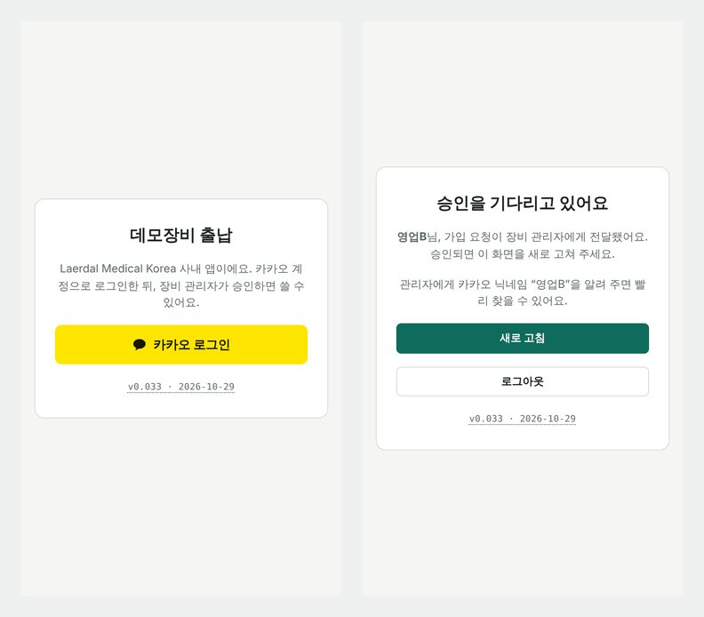
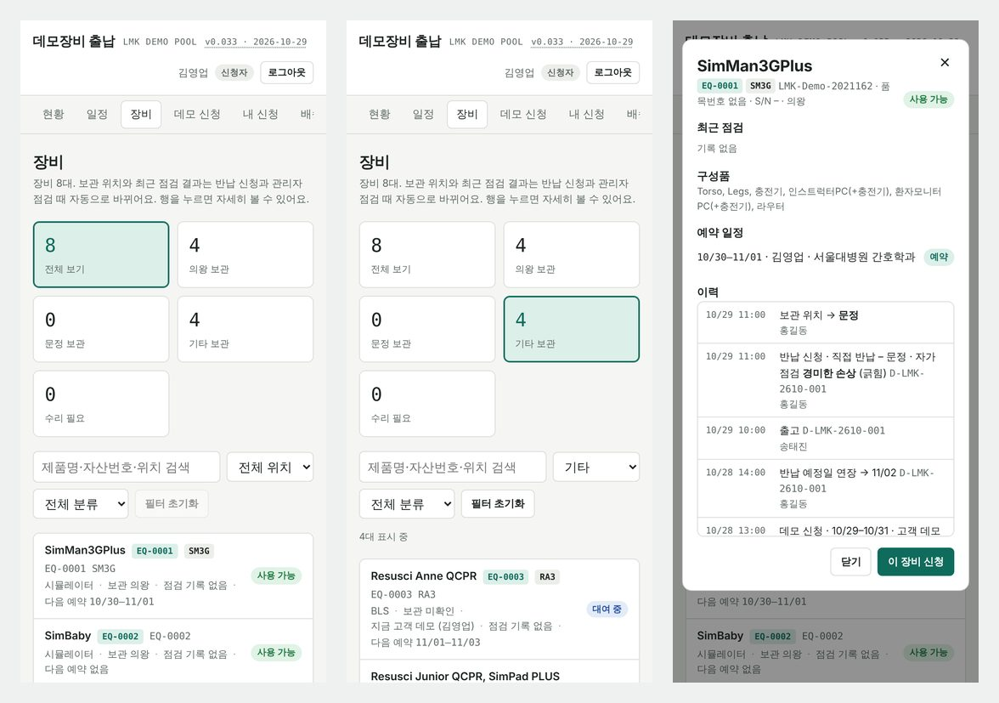
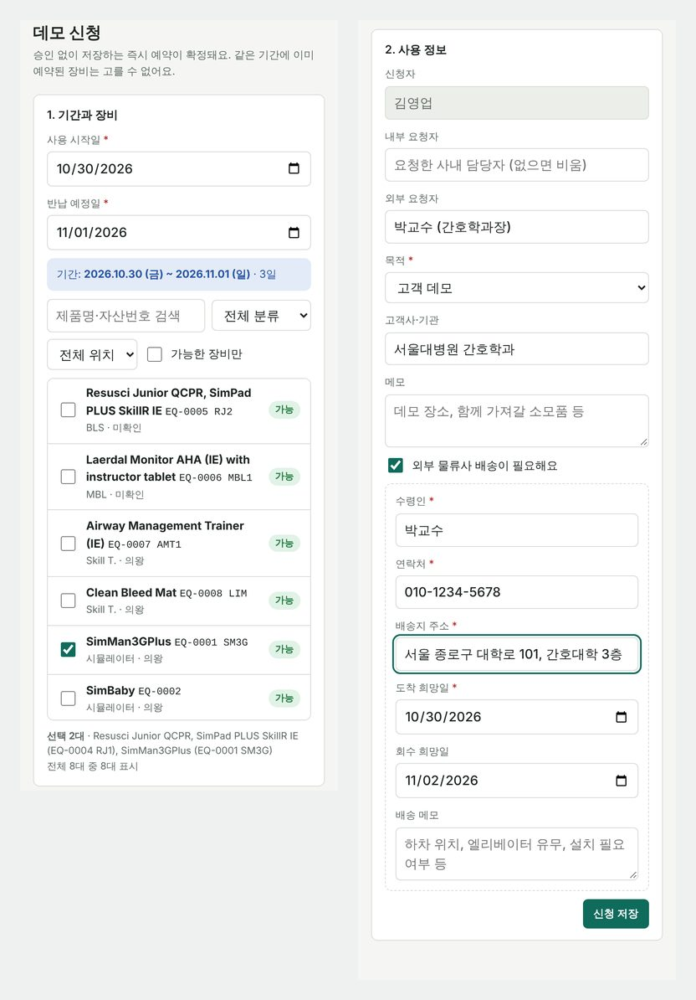
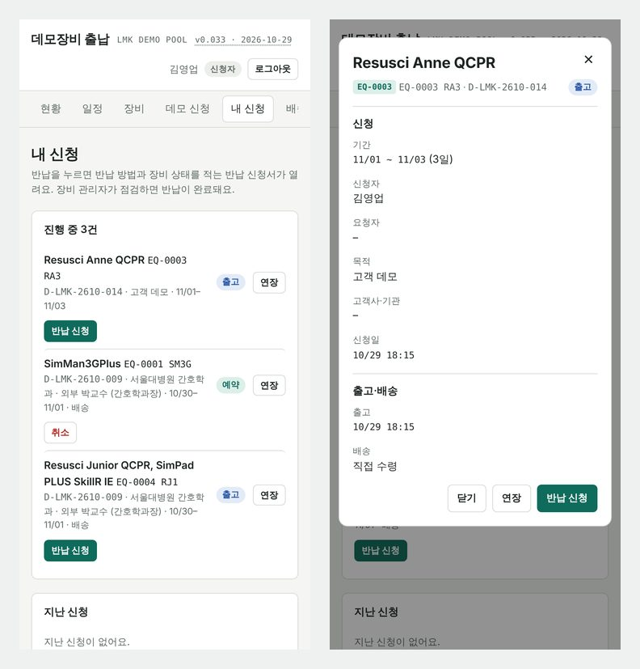
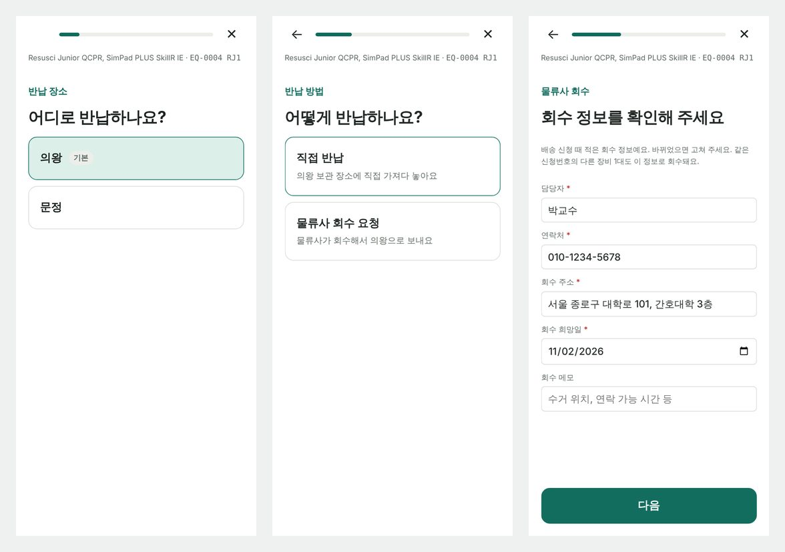
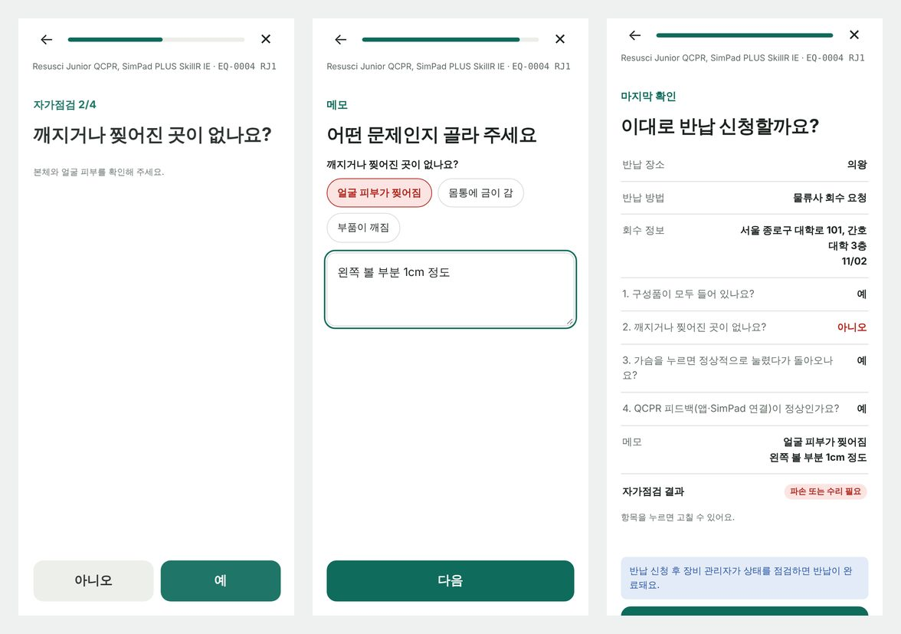
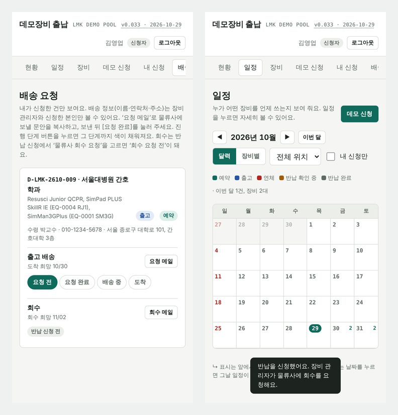
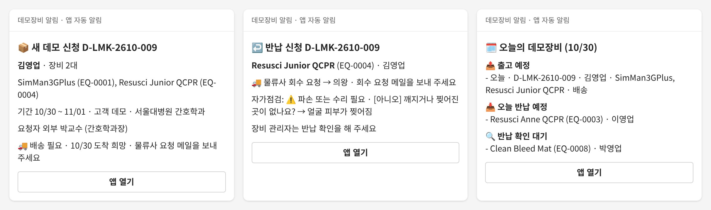

# 데모콕 사용자 매뉴얼

**데모콕**은 필요한 데모장비를 콕 찍어 신청하고 반납하는 사내 앱이에요. 이 안내서는 시범 운영 기간 동안 쓰는 일반 사용자용이에요. 장비 관리자 기능은 따로 안내해요.

## 시작하기

**접속 주소:** <https://lmk-apps.github.io/demo-equipment/>

1. 휴대폰이나 PC 브라우저에서 위 주소를 열어 주세요.
2. [**카카오 로그인**]을 눌러 카카오 계정으로 로그인해 주세요.
3. 처음 로그인하면 **승인 대기** 화면이 나와요. 장비 관리자에게 카카오 닉네임을 알려 주세요.
4. 관리자가 승인하면 [**새로 고침**]을 눌러 주세요. 바로 앱을 쓸 수 있어요.

**홈 화면에 추가해 두면 편해요.**

- 아이폰(Safari): 아래 공유 버튼 → **홈 화면에 추가**
- 안드로이드(Chrome): 오른쪽 위 ⋮ → **홈 화면에 추가**

앱에는 카카오 닉네임이 이름으로 보여요. 실명과 다르면 관리자에게 고쳐 달라고 해 주세요.

## 화면 구성

화면 위쪽 메뉴에서 원하는 화면으로 가요. 폰에서는 메뉴 줄을 옆으로 밀어 주세요.

| 메뉴 | 하는 일 |
|---|---|
| 현황 | 오늘 출고·반납 예정, 연체, 상태별 장비 수를 한눈에 봐요. |
| 일정 | 누가 어떤 장비를 언제 쓰는지 달력과 장비별로 봐요. 날짜를 눌러 바로 신청할 수도 있어요. |
| 장비 | 전체 장비의 보관 위치와 상태를 봐요. |
| 데모 신청 | 장비를 골라 빌려 달라고 신청해요. |
| 내 신청 | 내가 한 신청을 보고, 수정·연장·취소·반납 신청을 해요. |
| 배송 | 내 신청의 배송·회수 진행 상황을 봐요. |

모든 팝업 창은 오른쪽 위 ✕나 아래 [닫기]로 닫아요. 이 설명서는 앱 맨 아래와 로그인 화면의 [📖 사용 설명서]에서 다시 열 수 있어요. 화면 위 제목 옆의 버전 번호를 누르면 바뀐 내용을 볼 수 있어요.

## 장비 찾기

[**장비**] 메뉴에서 모든 데모장비를 볼 수 있어요.

- **위쪽 카드**를 누르면 그 조건의 장비만 보여요. (전체 보기, 의왕 보관, 문정 보관, 기타 보관, 수리 필요)
- **검색창**에 제품명, 라벨(예: RA1, SM3G), 자산번호, 위치를 넣어 찾을 수 있어요.
- **분류**(시뮬레이터, BLS, MBL, Skill T., 기타)와 **위치**로도 거를 수 있어요.
- 거른 조건은 [**필터 초기화**]나 [**전체 보기**] 카드로 한 번에 풀어요.

장비 줄을 누르면 상세 창이 열려요. 구성품, 예약 일정, 지난 이력을 볼 수 있고, [**이 장비 신청**]으로 바로 신청할 수 있어요.

> 장비마다 **EQ-0001** 같은 내부 ID가 있어요. 이름이나 자산번호가 바뀌어도 이 번호는 그대로예요. 장비 관리자와 이야기할 때 이 번호를 알려 주시면 빨라요.

- 상태 표시: **사용 가능** · **대여 중** · **점검 중** · **수리 중**
- 사용 가능 장비도 다른 날짜에 예약이 있을 수 있어요. 상세 창의 **예약 일정**을 확인해 주세요.

**QR 라벨로 찾기**

장비에 붙은 데모콕 QR 라벨을 찍으면 그 장비 화면이 바로 열려요. 거기서 신청하거나, 내가 빌린 장비면 [**반납 신청**]을 눌러 주세요.

1. [**현황**]이나 [**장비**] 화면에서 [**QR 찍기**]를 눌러 주세요.
2. 처음 한 번은 카메라 사용을 허용해 주세요.
3. 라벨을 화면의 네모 안에 맞추면 장비 화면이 열려요.

> 폰 기본 카메라나 카카오톡으로 찍어도 열려요. 하지만 그러면 브라우저에서 따로 로그인해야 하고, 그 브라우저도 로그인 기기 1대로 셈돼요(한 계정은 2대까지). 앱 안의 [**QR 찍기**]를 쓰시면 편해요.

## 데모 신청

[**데모 신청**] 메뉴에서 장비를 빌려요. **승인 없이 저장하는 즉시 예약이 확정돼요.** 같은 기간에 이미 예약된 장비는 고를 수 없어요.

**1. 기간과 장비**

- **사용 시작일**을 고르면 반납 예정일이 **3일 사용**으로 자동으로 맞춰져요. (예: 10/30 시작 → 11/01 반납)
- 반납 예정일은 직접 바꿀 수 있어요. 시작일부터 **최대 1달**까지 고를 수 있어요.
- 쓸 장비에 체크해 주세요. 여러 대를 한 번에 신청할 수 있어요. 검색, 분류, 위치, [**가능한 장비만**]으로 거르면 찾기 쉬워요.

**2. 사용 정보**

- **목적**(고객 데모, 전시회, 교육·워크숍, 학회, 내부 교육, 기타)을 골라 주세요.
- 내부 요청자, 외부 요청자, 고객사·기관, 메모는 아는 만큼 적어 주세요.
- 고객에게 물류사로 보내야 하면 [**외부 물류사 배송이 필요해요**]를 체크하고 수령인, 연락처, 주소, 도착 희망일을 적어 주세요. 회수 희망일도 적어 두면 좋아요.

[**신청 저장**]을 누르면 신청번호(예: D-LMK-2610-009)가 붙고 [**내 신청**]으로 이동해요.

> 배송을 체크하면 장비 관리자가 물류사에 배송을 요청해요. 진행 상황은 [**배송**] 메뉴에서 볼 수 있어요.

[**일정**] 메뉴의 달력에서 날짜를 눌러 신청을 시작할 수도 있어요.

## 내 신청

[**내 신청**] 메뉴에는 내가 한 신청이 장비별로 보여요. 진행 중인 신청은 위에, 끝난 신청은 아래 **지난 신청**에 있어요.

| 상태 | 뜻 | 할 수 있는 일 |
|---|---|---|
| 예약 | 신청이 확정됐고 아직 출고 전이에요. | 예약 수정, 연장, 예약 취소 |
| 출고 | 장비를 받아 쓰는 중이에요. | 연장, 반납 신청 |
| 반납 확인 중 | 반납 신청을 했고 관리자가 점검하고 있어요. | 기다리기 |
| 반납 완료 | 관리자 점검까지 끝났어요. | – |

줄을 누르면 **세부 정보** 창이 열려요. 기간, 요청자, 목적, 출고·배송, 반납 내용을 한눈에 볼 수 있고, 아래 버튼으로 바로 처리할 수 있어요.

**연장**

- [**연장**]을 누르고 새 반납 예정일을 골라 주세요.
- 시작일부터 **1달**까지 연장할 수 있어요. 더 길게 써야 하면 장비 관리자에게 요청해 주세요.
- 다음 예약과 기간이 겹치면 연장할 수 없어요.

**예약 수정**

- 출고 전 예약은 줄의 [**수정**]이나 세부 정보 창의 [**예약 수정**]으로 고쳐요.
- 신청 화면이 수정 모드로 열려요. 기간, 장비, 사용 정보, 배송 정보를 바꾸고 [**수정 저장**]을 눌러 주세요.
- 뺀 장비는 취소되고, 새로 고른 장비는 같은 신청번호에 더해져요.
- 장비가 한 대라도 출고됐으면 고칠 수 없어요. 그때는 연장이나 반납 신청을 이용해 주세요.
- 물류사에 배송을 이미 요청했으면 배송 칸은 잠겨요. 바꿔야 하면 장비 관리자에게 말해 주세요.
- 고치지 않고 나가려면 [**수정 그만두기**]를 눌러 주세요.

**예약 취소**

- 출고 전(예약 상태)에만 취소할 수 있어요. 출고된 뒤에는 반납 신청을 해 주세요.

**연체**

- 반납 예정일이 지나면 빨간 **연체** 표시가 붙고, [**현황**] 화면과 관리자 알림에도 나와요.
- 더 써야 하면 예정일이 지나기 전에 연장해 주세요.

## 반납 신청

장비를 다 쓰면 [**내 신청**]에서 그 장비의 [**반납 신청**]을 눌러 주세요. 한 화면에 한 가지씩 물어봐요. 위쪽 ←로 앞 단계에 돌아갈 수 있어요.

> **여러 대를 빌렸다면 한 번에 반납할 수 있어요.** 첫 화면에서 함께 반납할 장비를 골라 주세요. 처음에는 같은 신청번호의 장비가 모두 골라져 있어요. 장소, 방법, 회수 정보는 한 번만 묻고, 자가점검은 장비마다 해요. 메모 단계에서는 문제가 있는 장비마다 따로 적고, 모든 장비에 함께 전할 내용도 적을 수 있어요.

1. **반납 장소** – **의왕**(기본) 또는 **문정**을 골라 주세요.
2. **반납 방법** – **직접 반납**(보관 장소에 직접 가져다 놓기) 또는 **물류사 회수 요청**을 골라 주세요.
3. **회수 정보** (물류사 회수를 고른 경우만) – 담당자, 연락처, 회수 주소, 회수 희망일을 확인해 주세요. 배송 때 적은 정보가 미리 채워져 있어요.
4. **자가점검** – 장비 분류에 맞는 질문이 최대 5개 나와요. [**예**] 또는 [**아니오**]를 눌러 주세요.
5. **메모** – [**아니오**]를 고른 질문이 있으면 어떤 문제인지 보기에서 골라 주세요. 보기에 없으면 아래 칸에 직접 적어 주세요.
6. **확인** – 고른 내용을 한 번 더 보여줘요. 항목을 누르면 바로 고칠 수 있어요. [**반납 신청**]을 눌러 마무리해 주세요.

**분류별 자가점검 질문**

| 분류 | 질문 |
|---|---|
| 시뮬레이터 | 구성품(노트북 2대와 충전기 포함) · 깨짐·찢어짐 · 정상 작동 · 노트북 전원 종료 · 배터리 |
| BLS | 구성품 · 깨짐·찢어짐 · 가슴 압박 · QCPR 피드백 |
| MBL, Skill T., 기타 | 구성품 · 깨짐·찢어짐 · 정상 작동 |

**반납 신청 뒤에는**

- 상태가 **반납 확인 중**으로 바뀌어요. 장비 관리자가 점검하면 **반납 완료**가 돼요.
- 물류사 회수를 골랐다면, 관리자가 물류사에 회수를 요청하기 전까지 세부 정보 창에서 회수 장소와 정보를 고칠 수 있어요.
- 자가점검은 있는 그대로 답해 주세요. 문제를 미리 알면 다음 데모 전에 고칠 수 있어요.

## 배송 확인

[**배송**] 메뉴에는 내 신청 중 물류사를 쓰는 건만 보여요. 진행 단계는 장비 관리자가 바꿔요. 끝난 단계는 연한 초록색 ✓, 지금 단계는 진한 초록색으로 보여요.

- **출고 배송:** 요청 전 → 요청 완료 → 배송 중 → 도착
- **회수:** 회수 요청 전 → 회수 요청 완료 → 회수 완료 (반납 신청 전에는 **반납 신청 전**으로 보여요.)
- 운송장 번호가 등록되면 물류사 이름과 함께 보여요.

> 배송·회수 정보(이름, 연락처, 주소)는 신청한 본인과 장비 관리자만 볼 수 있어요. 모든 장비 반납이 끝나고 90일이 지나면 자동으로 지워져요.

## Teams 알림

앱에서 일이 생기면 Teams 채널에 자동으로 알림이 올라가요. 따로 할 일은 없어요. 알림의 [**앱 열기**]를 누르면 바로 앱으로 가요.

| 알림 | 언제 | 내용 |
|---|---|---|
| 📦 새 데모 신청 | 데모 신청을 저장하면 | 신청자, 장비, 기간, 목적, 배송 여부 |
| ↩️ 반납 신청 | 반납 신청을 하면 | 장비, 반납 장소·방법, 자가점검 결과와 메모, 연체 여부 (여러 대를 함께 반납하면 1건) |
| 🗓️ 오늘의 데모장비 | 평일 아침 9시 | 연체, 오늘·내일 출고 예정(금요일에는 월요일까지), 오늘 반납 예정, 내일 반납 예정(금요일에는 월요일까지), 반납 확인 대기 |
| ✏️ 예약 수정 | 출고 전 예약을 고치면 | 바뀐 내용 (기간, 더한 장비·뺀 장비, 사용 정보, 배송 정보) |
| ⏩ 반납 예정일 연장 | 연장하면 | 장비, 이전 반납일 → 새 반납일, 몇 번째 연장인지 |
| 🚫 예약 취소 | 예약을 취소하면 | 장비, 기간, 배송 건인지 |

- 내 이름이 **연체**, **오늘 반납 예정**, **내일 반납 예정**에 보이면 반납이나 연장을 챙겨 주세요.
- 알림 내용이 앱과 다르면 앱이 맞아요. 앱 화면을 기준으로 해 주세요.
- 알림이 아예 안 오거나 이상하면 장비 관리자에게 알려 주세요.

## 개인정보 안내

데모콕은 카카오 로그인을 **본인 확인용**으로만 써요. 앱이 보관하는 개인정보는 아래가 전부예요.

| 항목 | 언제 받나요 | 누가 볼 수 있나요 | 언제 지우나요 |
|---|---|---|---|
| 카카오 닉네임 | 처음 로그인할 때 | 장비 관리자 | 계정을 지울 때 |
| 표시 이름 (실명) | 관리자가 승인할 때 정해요 | 앱 사용자 모두 | 계정을 지울 때 |
| 신청 내용 (기간, 장비, 목적, 고객사·기관, 요청자 이름, 메모) | 데모 신청할 때 | 앱 사용자 모두 (일정·장비 화면) | 출납 기록으로 보관 |
| 배송·회수 정보 (수령인, 연락처, 주소, 배송 메모) | 배송이나 회수를 요청할 때 | 신청한 본인, 장비 관리자 | 모든 장비 반납이 끝나고 90일 뒤 자동 삭제 |
| 반납 자가점검, 사용 이력 (누가 언제 무엇을 했는지) | 앱을 쓸 때 | 앱 사용자 모두 (장비 이력) | 출납 기록으로 보관 |
| 로그인 기록 (시각, 기기·브라우저 이름) | 로그인할 때 | 장비 관리자 | 90일 뒤 자동 삭제 |

**자주 묻는 질문 – 개인정보**

| 질문 | 답 |
|---|---|
| 카카오 로그인 때 어떤 정보를 받나요? | 닉네임(필수)만 앱에서 써요. 프로필 사진과 이메일은 선택 항목이에요. 동의 화면에서 체크를 빼도 로그인돼요. |
| 사진과 이메일에 동의하면 어떻게 되나요? | 로그인 서비스(Supabase)의 계정 정보에 함께 저장돼요. 그러나 앱은 이 값을 화면에 보여 주지 않고, 알림이나 다른 기능에도 쓰지 않아요. 걱정되면 체크를 빼고 로그인해 주세요. |
| 카카오톡 친구, 대화, 전화번호를 보나요? | 아니요. 그런 항목은 요청하지 않아요. |
| 카카오톡으로 메시지나 광고를 보내나요? | 아니요. 앱 알림은 사내 Teams 채널로만 가요. |
| 앱이 내 카카오 비밀번호를 알아요? | 아니요. 로그인은 카카오 화면에서 하고, 앱은 “로그인했다”는 확인 결과만 받아요. |
| 카카오 로그인만 하면 누구나 쓸 수 있나요? | 아니요. 장비 관리자가 승인해야 앱 내용을 볼 수 있어요. 승인 전에는 아무것도 보이지 않아요. |
| 여러 기기에서 로그인할 수 있나요? | 동시에 2대(예: 폰과 PC)까지예요. 3번째 기기로 로그인하면 가장 오래된 로그인이 끊겨요. 계정을 다른 사람과 함께 쓰지 마세요. 내가 로그인하지 않았는데 끊겼다는 안내가 뜨면 장비 관리자에게 알려 주세요. |
| 로그인 기록을 남기나요? | 네. 로그인한 시각과 기기·브라우저 이름(예: iPhone · 카카오톡 앱)만 남겨요. IP 주소는 남기지 않아요. 장비 관리자만 볼 수 있고, 90일이 지나면 자동으로 지워져요. |
| 데이터는 어디에 저장돼요? | Supabase 데이터베이스(서울 리전)에 저장돼요. 장애에 대비해 매일 비공개 저장소에 백업해요. 백업에는 배송 연락처, 이메일, 로그인 기록을 빼고 저장해요. |
| 고객 연락처를 적어도 되나요? | 배송에 꼭 필요한 만큼만 적어 주세요. 메모에 주민번호 같은 민감한 정보는 적지 마세요. |
| 내 정보를 지우고 싶어요. | 장비 관리자에게 요청해 주세요. 카카오 연결은 카카오계정의 ‘연결된 서비스 관리’에서 직접 끊을 수 있어요. 다만 장비 출납 기록(언제 어떤 장비를 빌렸는지)은 회사 장비 관리를 위해 남겨요. |

## 시범 운영 안내

지금은 정식 운영 전 시범 운영 기간이에요. 실제 데모장비를 빌릴 때 앱으로 신청하고 반납해 주세요. 써 보고 불편한 점을 알려 주시면 바로 고쳐요.

- 화면 위 버전 번호가 자주 바뀔 수 있어요. 버전을 누르면 바뀐 내용을 볼 수 있어요. 앱을 쓰는 중에 새 버전이 나오면 화면 위에 [새로 고침] 안내가 떠요.
- 장비 정보(보관 위치, 자산번호, 라벨)는 아직 정리 중이에요. 위치가 **미확인**인 장비도 있어요.
- 이 매뉴얼의 화면은 테스트 데이터로 만들었어요. 실제 화면과 조금 다를 수 있어요.

**문제를 알리는 방법**

장비 관리자에게 아래 내용을 함께 보내 주세요.

1. 어느 화면에서 무엇을 하다가 생겼는지
2. 화면 캡처 (빨간 오류 문구가 보이게)
3. 화면 위 버전 번호, 신청번호나 장비 ID(EQ-0000)

**자주 묻는 질문**

| 질문 | 답 |
|---|---|
| 로그인했는데 승인 대기만 나와요. | 장비 관리자가 승인해야 써요. 카카오 닉네임을 알려 주고, 승인되면 [**새로 고침**]을 눌러 주세요. |
| 원하는 장비를 고를 수 없어요. | 그 기간에 다른 예약이 있거나 수리 중이에요. [**일정**]에서 빈 날짜를 찾아 주세요. |
| 1달보다 길게 써야 해요. | 장비 관리자에게 요청해 주세요. 관리자는 더 길게 연장할 수 있어요. |
| 신청을 잘못했어요. | 출고 전이면 [**수정**]으로 고치거나 [**예약 취소**] 후 다시 신청해 주세요. 출고 뒤면 장비 관리자에게 알려 주세요. |
| 반납 신청을 잘못했어요. | 장비 관리자에게 알려 주세요. 회수 정보는 물류사 요청 전까지 직접 고칠 수 있어요. |
| 화면이 예전 그대로예요. | 앱을 닫고 다시 열거나 [**새로 고침**]을 눌러 주세요. |
